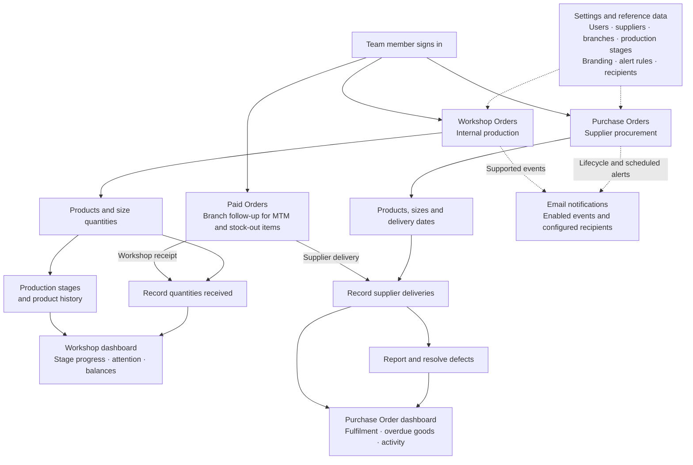
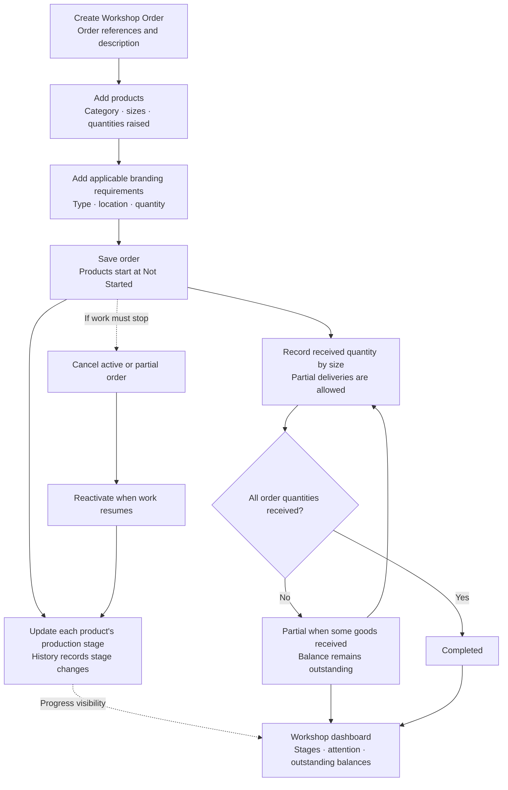
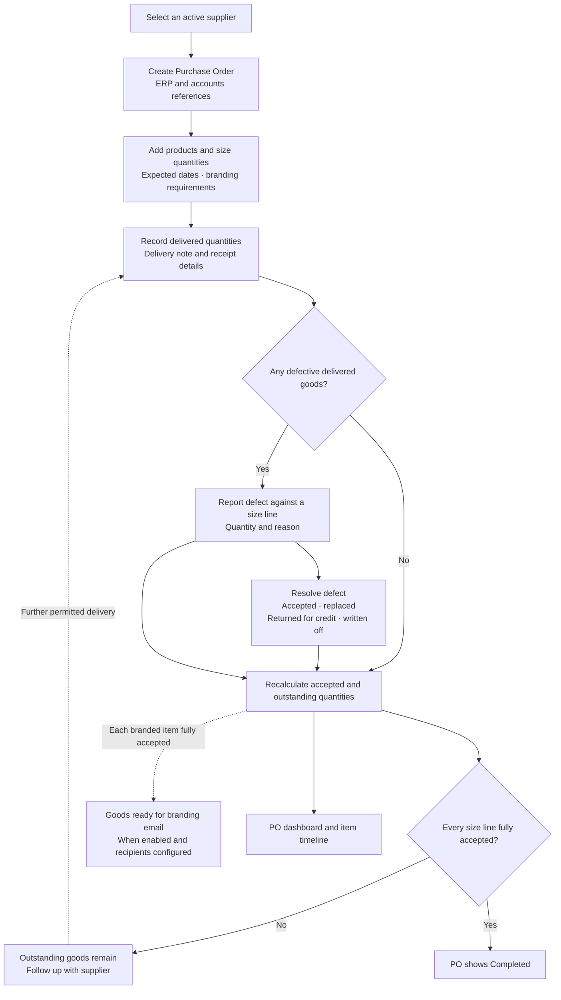
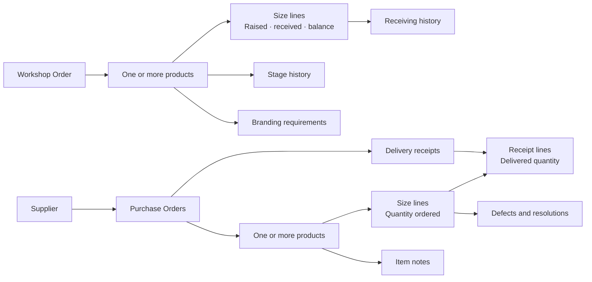
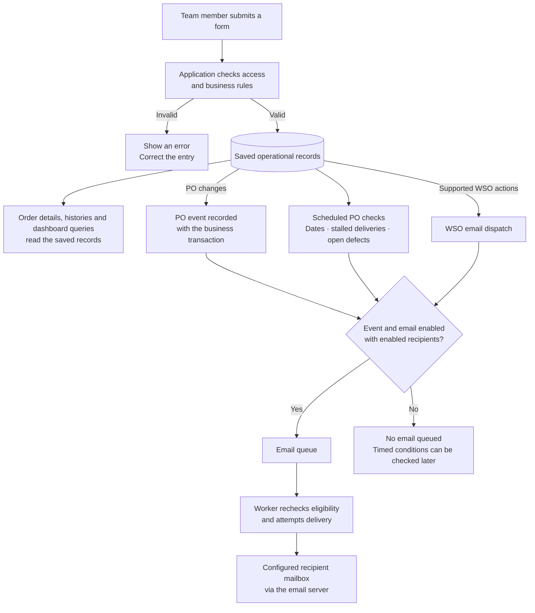
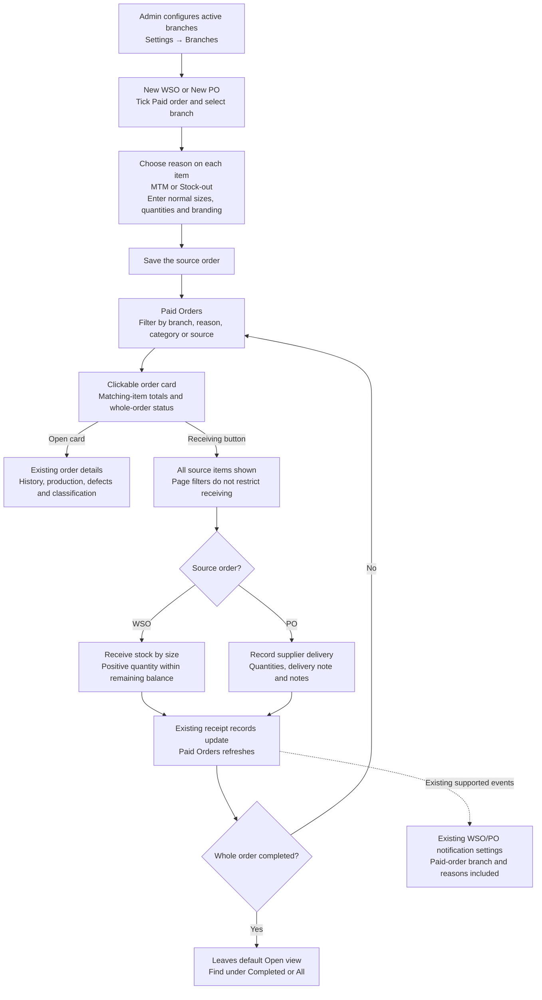

# Operations Platform: team training map

Based on the application source as at 27 October 2026. These charts describe implemented workflows, rather than a proposed future system. Open this Markdown document in a viewer with Mermaid support to display the charts.

## 1. Start here: the platform at a glance

Workshop Orders (WSOs) track internal production. Purchase Orders (POs) track goods procured from suppliers. They are separate order records sharing configuration, dashboards and email infrastructure. There is currently no automatic PO-to-WSO conversion or linked stock transfer.

**Trainer message:** Enter operational facts in the relevant order. The platform calculates balances and summaries from those records. A dashboard is a view of the work; an email is a prompt to review it. Solid arrows show operational flow; dotted arrows show configuration or supporting notifications.

## 2. Workshop Order: create, track, receive

**Teach the distinction:** Production stage belongs to a product. Order status reflects receiving. Moving a product to Ready For Dispatch does not itself record a receipt or complete its WSO. Stages are configurable; the seeded list is not proof that every product must visit every stage.

**Example exercise:** Raise 20 medium and 10 large shirts. Record 12 medium shirts received. The medium balance is 8, the large balance is 10, and the order is partial. Receive those remaining quantities to complete it.

**Current rules:** Receipts must be positive and cannot exceed the raised quantity. Completed and cancelled WSOs cannot be edited or received into; completed WSOs cannot be cancelled. Only cancelled WSOs can be reactivated. Reactivation restores active status; later receiving/status refresh recalculates fulfilment. Attachments provide supporting documents; uploading one does not receive goods.

## 3. Purchase Order: order, receive, inspect

**Teach these quantities:** Delivered is the recorded receipt total. Accepted is delivered less defects not resolved as accepted. Outstanding is ordered less accepted; check every size line, not just the order total.

**Example exercise:** Order 10 shirts, receive all 10, then report 2 defective. Delivered remains 10, accepted becomes 8, and outstanding becomes 2. Resolving those 2 as **accepted** restores accepted to 10. The PO can return to completed.

**Important current behavior:** Resolving a defect as replaced, returned for credit, or written off does not restore accepted quantity. A “replaced” resolution does not create a new receipt. The application currently prevents cumulative delivered quantity from exceeding the ordered quantity, so it does not provide a complete replacement-receipt workflow once the original quantity has already been delivered. Use this distinction in training rather than teaching a replacement automation that does not exist.

**Branding boundary:** A goods-ready email identifies a branded item that is fully accepted. It does not create a WSO, transfer stock or record branding completion automatically.

**Cancellation:** A cancelled PO blocks editing and receiving. Reactivation restores its active operational state. PO completion is calculated from quantities and can change after defects or quantity edits; it is not the same read-only rule used for completed WSOs.

## 4. How the records fit together

**Trainer message:** Use the order to identify the overall job, the product to identify what is being made or bought, and the size line to record quantities accurately. A PO receipt can contain several size lines; a defect is recorded against a particular size line.

## 5. What happens after someone saves data

**Trainer message:** Saving an order and delivering an email are separate steps. An email delay does not mean the order was not saved. Review the order record before creating a duplicate.

**PO alerts:** Created, cancelled, reactivated, completed, defect reported and branding goods ready; plus approaching deadline, overdue delivery, stalled partial delivery and unresolved defect alerts. Timed alerts send once per episode, with no daily reminders. Deadline dates use Africa/Nairobi. Alerts require event-specific recipients; a supplier contact is not automatically a recipient. In-app notifications remain deferred.

## 6. Where to work in the application

| Area | Team activity | Information produced |
| --- | --- | --- |
| Workshop Orders | Create internal work, update products, record receipts, attach documents | Production history and received/outstanding quantities |
| Workshop dashboard / production-stage views | Review work by stage and investigate attention items | Priorities for production and receiving follow-up |
| Purchase Orders | Raise supplier orders, record deliveries, report/resolve defects, add notes | Procurement history and accepted/outstanding quantities |
| Purchase Order dashboard | Review fulfilment, overdue goods and recent activity | Supplier follow-up priorities |
| Paid Orders | Filter by branch, item reason/category and source; open cards or use Receiving | Expedited follow-up using existing WSO/PO receipts |
| Settings → Branches | Administrators create branches and activate/deactivate them | Branch choices for paid orders; historical assignments remain available |
| Settings → Production Stages | Maintain available stages and expected durations | Consistent production tracking |
| Settings → Notification Behaviour / Recipients | Enable events and email; assign recipients per event | Targeted email alerts |
| Settings → receiving / PO alert thresholds | Configure attention and timed-alert rules | Consistent follow-up criteria |
| Settings → Users, Suppliers, Branding Types / Locations | Maintain accounts and reference data | Valid choices for operational records |

User management, supplier management and branding reference pages are admin-only in the frontend. Teach each person the screens available to their assigned account; a suggested business responsibility is not a separate permission role automatically enforced by the application.

## 7. Paid orders: classify, follow up and receive

Paid Orders is a combined follow-up page for paid WSOs and POs. Choose the source according to whether goods are made internally or bought from a supplier. Tick **Paid order**, choose one branch for the whole order, and choose **Make to measure (MTM)** or **Stock-out** separately for each item. A single order can contain MTM trousers and a stock-out fleece. Product category remains separate from the reason.

**Teach the scope:** Receiving means the existing workshop or supplier receipt. There is no separate branch-receipt confirmation. The receiving panel shows the entire order, even if the card only shows items matching an MTM or category filter. Record only what actually arrived; use **View order details and history** for the source record and follow-up actions.

**Read the cards correctly:** Each order appears once. Card quantities cover matching items; status belongs to the whole order. WSO fulfilment is received quantity. PO fulfilment is accepted quantity after defects, so outstanding units can remain even when the supplier delivery limit has been reached. The PO defect limitations in section 3 still apply. Completed/cancelled WSO restrictions and cancelled PO restrictions also apply here.

**Finding work:** The default view is Open, oldest first. Filter by branch, reason, category, WSO/PO, status, reference or creation dates. Dates use Nairobi time. Reason and category must match the same item. Use Refresh for an immediate update; the page also refreshes every minute. Ordinary WSO/PO lists default to Bulk with Paid and All options; dashboards include both. Use the New WSO/New PO buttons to start the appropriate creation form, then tick Paid order.

**Corrections and branches:** Open the source order and choose **Edit classification** to correct paid/bulk status, branch and item reasons together. Cancelled orders must first be reactivated. Changes are audited. Administrators maintain branches under Settings; deactivation prevents new assignments while preserving existing assignments and filter choices.

**Notifications:** Paid orders use the existing WSO/PO event switches and recipients, including applicable completion, product-received, branding-ready and attention alerts. They do not have a separate recipient list or a new email for every partial receipt. Paid-order emails have a `[Paid order]` subject prefix and include the branch and item reasons. Future PO event snapshots preserve that context; already queued messages are unchanged. The branch selection does not automatically select an email recipient. In-app notifications remain deferred.

**Example exercise:** Create a paid WSO for a training branch with 2 MTM trousers and 3 stock-out fleeces. Filter to MTM: the card shows 2 ordered. Click Receiving: both items appear. Receive 1 pair of trousers; the filtered card shows 1 received and 1 outstanding, while the order is partial. Clear the reason filter to see 5 ordered, 1 received and 4 outstanding. Receive the remaining quantities, then find the order under Completed. Repeat with a paid PO using Record Delivery and its delivery-note reference. Review configured notification events using approved training recipients.

## Suggested 40-minute training session

1. **Orient the team (5 minutes):** Walk through chart 1. Ask whether a sample requirement belongs in a WSO or a PO.
2. **Demonstrate a WSO (8 minutes):** Use chart 2 and the 30-shirt example. Show that stage changes and receiving are separate actions.
3. **Demonstrate a PO (10 minutes):** Use chart 3 and the 10-shirt defect example. Compare delivered, accepted and outstanding quantities before and after resolution.
4. **Demonstrate paid orders (10 minutes):** Use section 7's mixed-reason example. Compare filtered card totals with the full receiving panel, show both receipt entry points, and find a completed order again.
5. **Follow the saved data (4 minutes):** Open histories and dashboards. Use charts 4 and 5 to explain why an email is not the authoritative record. Show that paid orders use the source module's notification settings.
6. **Check understanding (3 minutes):** Ask “Does Ready For Dispatch complete a WSO?”, “Does resolving as replaced add a receipt?”, “Does a supplier contact or branch selection automatically choose email recipients?”, and “Does the MTM filter hide other items in the receiving panel?” The answer to each is no.

Use designated training records. If demonstrating with email-enabled events, use approved training recipients because real saved actions can send real emails.

## Maintenance references

The charts were checked against frontend routes and Settings pages; paid-order cards and receiving dialogs; backend WSO/PO business rules, receiving and defect services; seeded production stages; and notification snapshots, dispatch and worker code. For technical setup see [README](../README.md); for detailed notification policy see [PO email notifications](po-email-notifications.md); for paid-order configuration and migration steps see the [paid-orders guide](paid-orders.md). Update these charts when those workflows change.
